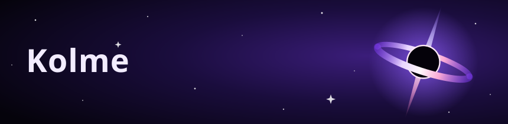

Colombian studying in Berlin  , **Software Engineering** student.

### 🚀 Projects

| Project | What it is |
|---|---|
| **Orbyte** | My personal AI: it only follows my instructions and recognizes only my voice; it uses AI and controls my PC with my permission. When I’m away from the PC, I talk to Orbyte through Telegram: alerts, instructions, tasks, reminders, etc. `Python` `Flask` `JavaScript` |
| **Modo Carrera** | Football manager web game, still in progress: transfers, matches and seasons from Europe’s top leagues. `JavaScript` `HTML` `CSS` |
| [kolmme.github.io](https://kolmme.github.io/portafolio.html) | My personal website: my CV turned into a web page. `HTML` `CSS` |

### ⭐ Orbyte in action

### 🛠️ Tech

     

### 📊 Stats

### 📚 Currently learning

- 🧠 AI & machine learning
-  Python
- 🔐 Computer science & cybersecurity fundamentals
-  German (B1)

### 📫 Where to find me

🌐 [My portfolio & CV](https://kolmme.github.io/portafolio.html)
