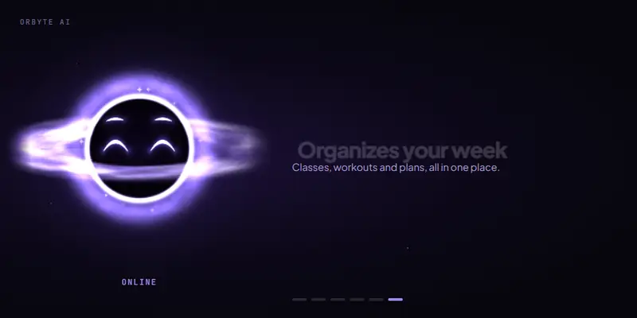

Colombian studying in Berlin  , **Software Engineering** student.

### 🚀 Projects

| Project | What it is |
|---|---|
| **[Orbyte AI](https://kolmme.github.io/orbyte.html)** | My personal AI assistant and my biggest project: I work on it every day to make it better. She helps me code, study and organize my week, and like any AI chatbot you can ask her anything and she answers. She lives on my PC and on my phone. `Python` `Flask` `JavaScript` `Claude API` |
| **Modo Carrera** | Football manager web game, still in progress: transfers, matches and seasons from Europe’s top leagues. `JavaScript` `HTML` `CSS` |
| [kolmme.github.io](https://kolmme.github.io/) | My portfolio: what I’m studying, my projects, the studies I’ve finished and how to contact me. `HTML` `CSS` `JavaScript` |

### ⭐ Orbyte in action

➡️ [Read the Orbyte AI case study](https://kolmme.github.io/orbyte.html)

### 🛠️ Tech

        

### 📚 Currently learning

- 🧠 AI & machine learning
-  Python
- 🔐 Computer science & cybersecurity fundamentals
-  German (B1)

### 📫 Where to find me

🌐 [My portfolio](https://kolmme.github.io/)
